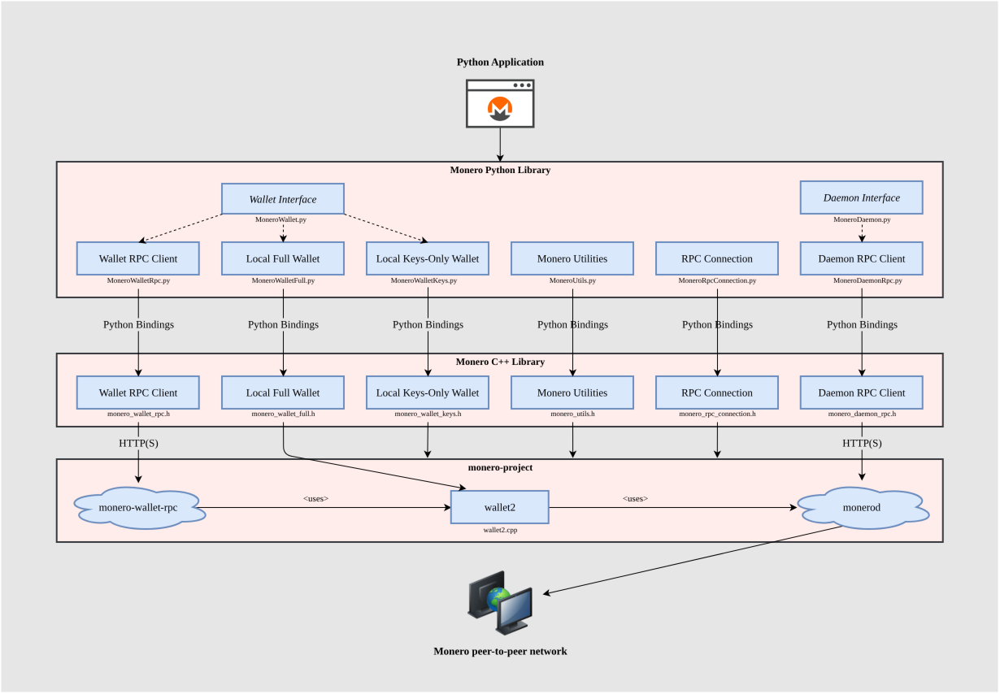

# Monero Python Library

[](https://github.com/libmonero/monero-python/actions/workflows/ci.yml)
[](https://app.codacy.com/gh/libmonero/monero-python/dashboard?utm_source=gh&utm_medium=referral&utm_content=&utm_campaign=Badge_grade)
[](https://app.codacy.com/gh/libmonero/monero-python/dashboard?utm_source=gh&utm_medium=referral&utm_content=&utm_campaign=Badge_coverage)

[](https://github.com/pybind/pybind11)
[](https://github.com/libmonero/monero-python#monero-python-library)
[](https://libmonero.github.io/monero-python/)
[](https://matrix.to/#/#monero-python:monero.social)

A Python library for creating Monero applications using RPC and Python bindings to [monero v0.18.5.3 'Fluorine Fermi'](https://github.com/monero-project/monero/tree/v0.18.5.3).

* Supports wallet and daemon RPC clients.
* Supports client-side wallets using Python bindings.
* Supports a keys-only wallet, which has the keys, the seed and the addresses of an account and needs no daemon.
* Supports multisig, view-only, and offline wallets.
* Wallet types are interchangeable by conforming to a [common interface](https://libmonero.github.io/monero-python/api/wallet/).
* Uses a clearly defined [data model and API specification](https://github.com/libmonero/monero-python/blob/main/docs/monero-spec.pdf) intended to be intuitive and robust.
* Query wallet transactions, transfers, and outputs by their properties.
* Fetch and process binary data from the daemon (e.g. raw blocks).
* Receive notifications when blocks are added to the chain or when wallets sync, send, or receive.

## Architecture

<p align="center">
	<br>
	<i>Build Python applications using RPC or Python bindings to <a href="https://github.com/monero-project/monero">monero-project/monero</a>.  Wallet implementations are interchangeable by conforming to a common interface, <a href="https://libmonero.github.io/monero-python/api/wallet/">MoneroWallet</a>.</i>
</p>


## Sample code

<!-- --8<-- [start:sample-code] -->
```python
from monero import *

# custom wallet listener implementation
class MyWalletListener(MoneroWalletListener):
    def on_sync_progress(self, height: int, start_height: int, end_height: int, percent_done: float, message: str) -> None:
        pass # feed a progress bar?

    def on_output_received(self, output: MoneroOutputWallet) -> None:
        amount: int | None = output.amount
        tx_hash: str | None = output.tx.hash
        is_confirmed: bool | None = output.tx.is_confirmed
        is_locked: bool | None = output.tx.is_locked

# connect to daemon
daemon: MoneroDaemon = MoneroDaemonRpc("http://localhost:38081", "superuser", "abctesting123")
height: int = daemon.get_height() # 1523651
txs_in_pool: list[MoneroTx] = daemon.get_tx_pool() # get transactions in the pool

# create wallet from mnemonic phrase using Python bindings to monero-project

wallet_config = MoneroWalletConfig()
wallet_config.path = "sample_wallet_full"
wallet_config.password = "supersecretpassword123"
wallet_config.network_type = MoneroNetworkType.STAGENET
wallet_config.server = MoneroRpcConnection("http://localhost:38081", "superuser", "abctesting123")
wallet_config.seed = "hefty value scenic..."
wallet_config.restore_height = 573936
wallet_full: MoneroWallet = MoneroWalletFull.create_wallet(wallet_config)

listener: MoneroWalletListener = MyWalletListener()

# synchronize the wallet and receive progress notifications
wallet_full.sync(listener)

# synchronize in the background every 5 seconds
wallet_full.start_syncing(5000)

# receive notifications when funds are received, confirmed, and unlocked
wallet_full.add_listener(listener)

# connect to wallet RPC and open wallet
wallet_rpc: MoneroWallet = MoneroWalletRpc("http://localhost:38083", "rpc_user", "abc123")
wallet_rpc.open_wallet("sample_wallet_rpc", "supersecretpassword123")
primary_address: str = wallet_rpc.get_primary_address() # 555zgduFhmKd2o8rPUz...
balance: int = wallet_rpc.get_balance() # 533648366742
txs: list[MoneroTxWallet] = wallet_rpc.get_txs() # get transactions containing transfers to/from the wallet

# send funds from RPC wallet to full wallet
tx_config = MoneroTxConfig()
tx_config.account_index = 0
tx_config.address = wallet_full.get_address(1, 0)
tx_config.amount = 250000000000 # send 0.25 XMR (denominated in atomic units)
tx_config.relay = False # create transaction and relay to the network if true

created_tx: MoneroTxWallet = wallet_rpc.create_tx(tx_config)
fee: int | None = created_tx.fee # "Are you sure you want to send... ?"
wallet_rpc.relay_tx(created_tx) # relay the transaction

# save and close wallet
wallet_full.close(True)
```
<!-- --8<-- [end:sample-code] -->

## Installation

<!-- --8<-- [start:installation] -->

Every [release](https://github.com/libmonero/monero-python/releases) has prebuilt packages attached:

* Debian and Ubuntu: `python3-monero_<version>-1<distro>1_<arch>.deb` for `bookworm`, `trixie`, `jammy` and `noble` on `amd64`, `arm64` and `armhf`, installed for the system Python 3:
    ```bash
    sudo apt install ./python3-monero_0.9.11-1noble1_amd64.deb
    ```
* macOS and Windows: one wheel per Python version, `monero-<version>-<python>-<platform>.whl`:
    ```bash
    pip3 install monero-0.9.11-cp313-cp313-win_amd64.whl
    ```

On anything else, build it from source.

<!-- --8<-- [end:installation] -->

## Building monero-python from source

### Linux and macOS

<!-- --8<-- [start:build-linux-macos] -->

1. Clone the project repository:
    ```bash
    git clone --recurse-submodules https://github.com/libmonero/monero-python.git
    ```
2. Install the build dependencies, on Ubuntu and Debian with the script that CI uses (the packages of apt for monero-project, monero-cpp and the module, and `python3-venv` for the virtual environment of the tests):
    ```bash
    cd monero-python
    ./bin/install_dependencies_linux.sh
    ```
    On other systems, follow the [instructions](https://github.com/woodser/monero-cpp#using-monero-cpp-in-your-project) of monero-cpp.
3. Build monero-project and the monero-cpp submodule (located at `./external/monero-cpp`): `./bin/build_monero_cpp.sh`. It runs 3 jobs, a compiler of monero takes up to 1.5 GB of memory: set `JOBS` for more or fewer.
4. Build monero-python to `./build/`:<br>
    ```bash
    mkdir -p build
    cd build
    cmake ..
    make
    ```
5. Or build and install monero-python with pip:
    ```bash
    pip3 install . --break-system-packages
    ```
6. Or run build script: `./bin/build_libmonero_python.sh`

> **VS Code:** the repository has a configuration in [.vscode](https://github.com/libmonero/monero-python/tree/main/.vscode): the tasks build monero-cpp and the module, start the docker test environment, run the tests with coverage, lint the workflows (`bin/lint_workflows.sh`, with the actionlint and zizmor of CI) and build or serve the docs (`bin/docs.sh`), the launch configurations debug the tests, in python and in the C++ of the module (with gdb, on a debug build in `build-debug/`), and the Testing panel finds the module in `build/` ([.vscode/.env](https://github.com/libmonero/monero-python/blob/main/.vscode/.env)). It recommends the extensions that it uses.

> **Faster rebuilds:** if [ccache](https://ccache.dev/) is installed it is used automatically for monero and monero-python (pass `-DUSE_CCACHE=OFF` to cmake to disable it). To use it for monero-cpp as well, build that with `-DCMAKE_C_COMPILER_LAUNCHER=ccache -DCMAKE_CXX_COMPILER_LAUNCHER=ccache`.

<!-- --8<-- [end:build-linux-macos] -->

### Debian package

<!-- --8<-- [start:build-debian] -->

The package is built from [debian/](https://github.com/libmonero/monero-python/tree/main/debian) with `dpkg-buildpackage`, the way CI does it. It installs the build dependencies and some static libraries system wide, so build it in a container of the release you want it for (`ubuntu:24.04`, `ubuntu:22.04`, `debian:trixie` or `debian:bookworm`).

1. Install [Docker](https://docs.docker.com/engine/install/)
2. Clone the repository
    ```sh
    git clone --recursive https://github.com/libmonero/monero-python.git
    ```
3. Build, replacing `ubuntu:24.04` with the release you want
    ```sh
    docker run --rm -it -v <MONERO_PYTHON_DIR_FULL_PATH>:/monero-python -w /monero-python ubuntu:24.04 bash -c '
      apt-get update && apt-get install -y dpkg-dev &&
      apt-get build-dep -y ./ &&
      debian/set-version.sh &&
      dpkg-buildpackage --build=binary --no-sign &&
      mkdir -p debian/artifacts && mv ../python3-monero_* debian/artifacts/'
    ```

    * `MONERO_PYTHON_DIR_FULL_PATH` - full path to `monero-python` directory
    * `debian/set-version.sh` adds an entry for the version of `pyproject.toml` to `debian/changelog`, there is no need to commit it
    * add `--jobs=4` to `dpkg-buildpackage` to build faster, each compiler needs 1 to 2 GB of memory

4. The package is placed in `monero-python/debian/artifacts`

<!-- --8<-- [end:build-debian] -->

### Windows

<!-- --8<-- [start:build-windows] -->

1. Download and install [MSYS2](https://www.msys2.org/).
2. Press the Windows button and launch `MSYS2 MINGW64`.
3. Update packages: `pacman -Syu` and confirm at prompts.
4. Relaunch MSYS2 (if necessary) and install dependencies:

     ```
     pacman -S mingw-w64-x86_64-toolchain make mingw-w64-x86_64-cmake mingw-w64-x86_64-openssl mingw-w64-x86_64-zeromq mingw-w64-x86_64-libsodium mingw-w64-x86_64-unbound mingw-w64-x86_64-protobuf git gettext base-devel wget
     ```

5. Clone repo: `git clone --recurse-submodules https://github.com/libmonero/monero-python.git`
6. Install the packages at the versions that CI uses (ICU, hidapi and libusb, boost, pybind11, and OpenSSL with the packages that link to it). [bin/msys2_pins.txt](https://github.com/libmonero/monero-python/blob/main/bin/msys2_pins.txt) has them with their sha256, and the script downloads, checks and installs a group of them:

     ```
     cd monero-python
     for group in icu hidapi-libusb boost pybind11 openssl; do bin/install_msys2_pins.sh $group; done
     ```

     hidapi and libusb were removed from the msys2 mingw64 repo, the script installs the archived packages. OpenSSL is at 3.6.5 because the net_ssl.cpp of monero-project does not build with OpenSSL 4, and the packages that link to it go back with it (unbound, ldns, curl, libarchive, hiredis, libssh2 and ngtcp2): the ones of the repo are rebuilt against OpenSSL 4. CI also pins the MinGW toolchain (`bin/install_msys2_pins.sh toolchain`), see [build-windows.yml](https://github.com/libmonero/monero-python/blob/main/.github/workflows/build-windows.yml).

7. Build monero-cpp, located as a submodule at ./external/monero-cpp:

    ```
    cd external/monero-cpp
    ./bin/build_libmonero_cpp.sh
    cd ../..
    ```

8. Build monero-python:

    ```
    mkdir -p build &&
    cd build &&
    cmake ..
    cmake --build .
    ```

9. Or run build script: `./bin/build_libmonero_python.sh`

<!-- --8<-- [end:build-windows] -->

## Use RPC servers in your project:

1. Download and install [Monero CLI](https://web.getmonero.org/downloads/).
2. Start monerod, e.g.: `./monerod --stagenet` (or use a remote daemon).
3. Start monero-wallet-rpc, e.g.: `./monero-wallet-rpc --daemon-address http://localhost:38081 --stagenet --rpc-bind-port 38083 --rpc-login rpc_user:abc123 --wallet-dir ./`

> [!NOTE]
> On Windows, first install MSYS2:
> 1. Install [MSYS2](https://www.msys2.org/).
> 2. Environment variables > System variables > Path > Edit > New > C:\msys64\mingw64\bin


## Memory Growth

If you see unrestricted memory growth using monero-python, consider applying [jemalloc](https://jemalloc.net/) to improve memory management with `malloc`. In many cases, this can completely resolve the memory growth.

For example: `export LD_PRELOAD=/path/to/libjemalloc.so.2` then run your app. It has to be the shared library, on Debian and Ubuntu it comes with the `libjemalloc2` package. A static `.a` archive is ignored.

## Running Python tests

1. Install the test dependencies, with the versions that the CI runs the tests with ([tests/requirements.txt](tests/requirements.txt)), in a virtual environment:
    ```bash
    python3 -m venv .venv
    . .venv/bin/activate
    pip install -r tests/requirements.txt
    ```
    Or, to work on the library, everything at once: `./bin/setup_venv.sh` makes `.venv` with the tools that build the module, run the tests and make the docs, at the versions of CI.
    The `monero` module has to be importable in it: install it in the environment (`pip install .`), or set `PYTHONPATH` to the folder that has the built module.

    Run `pytest` from that environment, or as `python3 -m pytest`. The `/usr/bin/pytest` of the `python3-pytest` package of apt calls `pytest.console_main()`, which pytest 9 deprecates, and with a newer pytest installed with pip it prints a `PytestRemovedIn10Warning`. The `pytest` that pip makes in the environment does not.
2. Clone the project repository: 
    ```bash
    git clone --recurse-submodules https://github.com/libmonero/monero-python.git

    cd monero-python
    ```
3. Setup docker test environment
    ```bash
    docker compose -f tests/docker-compose.yml up -d node_1 node_2 xmr_wallet_1 xmr_wallet_2 xmr_wallet_3
    ```
4. Or start RPC servers locally:
	1. Download and install [Monero CLI](https://web.getmonero.org/downloads/).
	2. Start monerod, e.g.: `./monerod --stagenet` (or use a remote daemon).
	3. Start monero-wallet-rpc, e.g.: `./monero-wallet-rpc --daemon-address http://localhost:38081 --stagenet --rpc-bind-port 38083 --rpc-login rpc_user:abc123 --wallet-dir ./`
5. Configure the appropriate RPC endpoints, authentication, and other settings in [config.ini](tests/config/config.ini).
6. Run all python tests with:
    ```bash
    pytest
    ```
    The tests assume the RPC servers of the docker environment. If you started them locally, set `IN_CONTAINER=false`.

    To run only the unit tests, which need no daemon or wallet RPC server:
    ```bash
    pytest -m unit
    ```

    The wallet tests are in [tests/wallet](tests/wallet), a file for each topic (`test_sweep.py`, `test_txs.py`, `test_outputs.py`...). Each file has a base class with the tests that every wallet should pass, and a class for each wallet type (`TestMoneroWalletFullSweep`, `TestMoneroWalletRpcSweep`, `TestMoneroWalletKeysSweep`) with what that type does differently. To run one topic, or one wallet type:
    ```bash
    pytest tests/wallet/test_sweep.py
    pytest tests/wallet -k Rpc
    ```

    The daemon tests are split in the same way: [tests/daemon/rpc](tests/daemon/rpc) has the integration tests of the rpc daemon (a file for each topic, such as `test_blocks.py`, `test_tx_pool.py` and `test_peers.py`), [tests/daemon/model](tests/daemon/model) the unit tests of the daemon models, grouped by model, and [tests/daemon/test_interface.py](tests/daemon/test_interface.py) the ones of the daemon interface.

    The wallet models are tested in [tests/wallet/model](tests/wallet/model) (a file for each kind of model: queries, transfers, outputs, accounts...), the calls of the wallet interface in [tests/wallet/test_interface.py](tests/wallet/test_interface.py), and the tests of what is not about a wallet or a daemon, such as the rpc connection, in [tests/common](tests/common), where the tests of `MoneroUtils` are split by topic in [tests/common/monero_utils](tests/common/monero_utils).
7. Cleanup docker test environment
    ```bash
    docker compose -f tests/docker-compose.yml down -v
    ```

## Related projects

* [monero-cpp](https://github.com/woodser/monero-cpp)
* [monero-c](https://github.com/libmonero/monero-c)
* [monero-java](https://github.com/woodser/monero-java)
* [monero-kotlin](https://github.com/libmonero/monero-kotlin)
* [monero-ts](https://github.com/woodser/monero-ts)
* [monero-csharp](https://github.com/libmonero/monero-csharp)

## License

This project is licensed under MIT.

## Sponsors
We would like to thank our sponsors for their financial contributions that keep this project up and running!

<table>
    <tr>
        <th>
            <br>
            Monero Community
        </th>
        <td>
            The maintenance of this project for a first stable release has been generously funded by the Monero Community Crowdfunding System (see <a href="https://repo.getmonero.org/monero-project/ccs-proposals/-/merge_requests/598">proposal</a>).
        </td>
    </tr>
</table>

## Donations

If this library has been valuable to you, please consider donating to support its continued development. 🙏

<p align="center">
  <code>XMR</code><br>
	<br>
	<code>84rXAu3QhsfbQ2vbxyoEptbRLZ2gtyL8k2qCeJwM5AU4FcxVDEbLRuxMZD5pXD1TR295Nodn7y9mkjoMemHrnMqa9ZnJTza</code>
</p>
