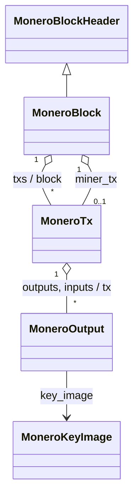

# Daemon Data Model

What the methods of a [daemon](../../daemon.md) take and return, by topic. The classes of a block and of a transaction are the ones that
the wallets extend ([Wallet Data Model](../wallet.md)).

A block has its transactions, and each transaction its block; a transaction has its outputs and its inputs, which are the outputs that
it spends, and each of them its transaction. A wallet extends these classes with what it knows ([Wallet Data Model](../wallet.md)).

| Page | What it has |
| --- | --- |
| [Blocks and the Chain](blocks.md) | the headers and the blocks, the alternative chains, the hard forks, the pruning |
| [Transactions and Outputs](transactions.md) | the transactions, their outputs and key images, the pool, the fees, the distribution of the outputs |
| [The Daemon and its Network](network.md) | the network type, the version and the state of the daemon, its sync, its peers and bans, its updates, its listener |
| [Mining](mining.md) | the mining status, the templates of blocks, the blocks mined on demand, merged mining |
