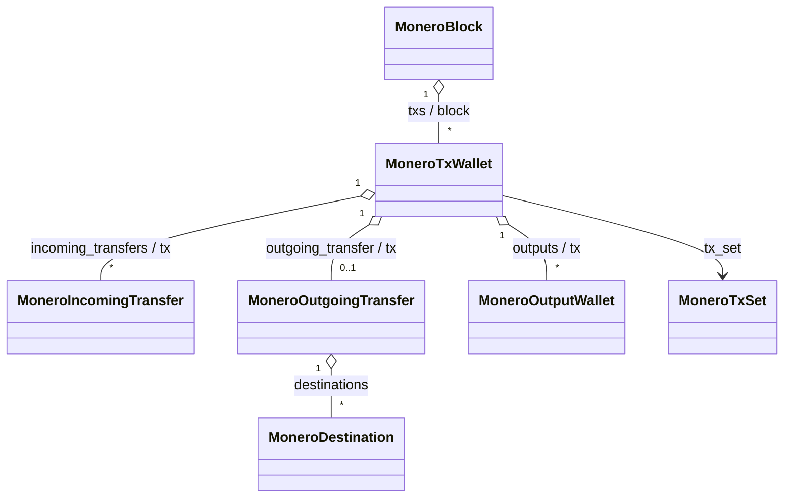
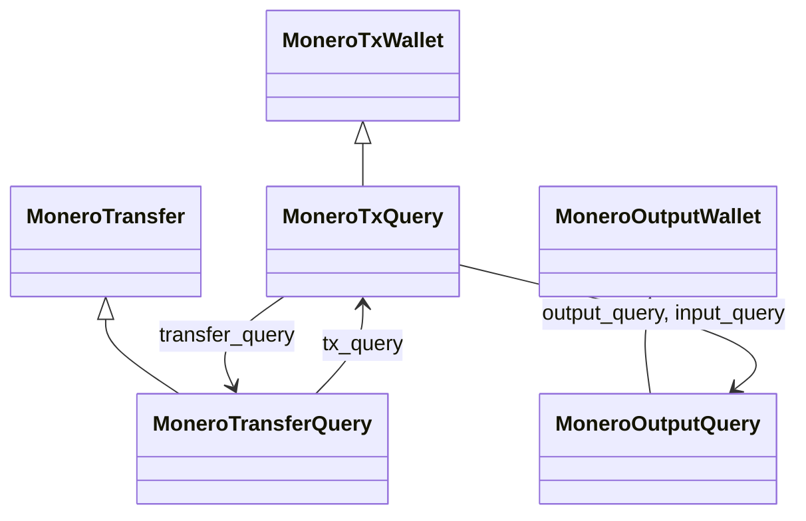

# Wallet Data Model

What the methods of a [wallet](../wallet.md) take and return, by role. A wallet extends the classes of the daemon with what it knows of
its own: a [`MoneroTxWallet`][monero.MoneroTxWallet] is a [`MoneroTx`][monero.MoneroTx] with its transfers, a
[`MoneroOutputWallet`][monero.MoneroOutputWallet] a [`MoneroOutput`][monero.MoneroOutput] with its account and subaddress
([Daemon Data Model](daemon.md)).

The graph of a transaction of a wallet: each link is there both ways, the name before the slash from the left, the one after from the
right, and [`MoneroUtils.free`][monero.MoneroUtils.free] breaks them ([Memory](../architecture.md#memory)).

A query is the class that it selects, and holds the queries of the others:

## What a call takes

| Class | What it is | For |
| --- | --- | --- |
| [`MoneroWalletConfig`][monero.MoneroWalletConfig] | how to create or open a wallet: path, password, network, seed or keys, daemon | [`MoneroWalletFull.create_wallet`][monero.MoneroWalletFull.create_wallet], [`MoneroWalletRpc.create_wallet`][monero.MoneroWalletRpc.create_wallet], the functions of [`MoneroWalletKeys`][monero.MoneroWalletKeys] |
| [`MoneroTxConfig`][monero.MoneroTxConfig], [`MoneroDestination`][monero.MoneroDestination], [`MoneroTxPriority`][monero.MoneroTxPriority] | a payment to make: its `destinations`, each an address and an amount, the account to pay from, the priority of its fee, whether to relay it | [`create_tx`][monero.MoneroWallet.create_tx], [`create_txs`][monero.MoneroWallet.create_txs], [`sweep_unlocked`][monero.MoneroWallet.sweep_unlocked] |
| [`MoneroTxQuery`][monero.MoneroTxQuery], [`MoneroTransferQuery`][monero.MoneroTransferQuery], [`MoneroOutputQuery`][monero.MoneroOutputQuery] | which transactions, transfers or outputs to get: each is the class that it selects, with the fields to match, and can hold the query of the others (`tx_query`, `transfer_query`, `output_query`) | [`get_txs`][monero.MoneroWallet.get_txs], [`get_transfers`][monero.MoneroWallet.get_transfers], [`get_outputs`][monero.MoneroWallet.get_outputs] |
| [`MoneroMessageSignatureType`][monero.MoneroMessageSignatureType] | which key signs a message | [`sign_message`][monero.MoneroWallet.sign_message] |

## What a wallet has

| Class | What it is | From |
| --- | --- | --- |
| [`MoneroAccount`][monero.MoneroAccount], [`MoneroSubaddress`][monero.MoneroSubaddress] | an account, with its balance and its `subaddresses`, and a subaddress with its own | [`get_accounts`][monero.MoneroWallet.get_accounts], [`get_subaddresses`][monero.MoneroWallet.get_subaddresses] |
| [`MoneroAccountTag`][monero.MoneroAccountTag] | a tag that groups accounts | [`get_account_tags`][monero.MoneroWallet.get_account_tags] |
| [`MoneroIntegratedAddress`][monero.MoneroIntegratedAddress] | an address with a payment ID | [`get_integrated_address`][monero.MoneroWallet.get_integrated_address], [`decode_integrated_address`][monero.MoneroWallet.decode_integrated_address] |
| [`MoneroDecodedAddress`][monero.MoneroDecodedAddress], [`MoneroAddressType`][monero.MoneroAddressType] | an address, with its network and its type: standard, integrated or subaddress | |
| [`MoneroAddressBookEntry`][monero.MoneroAddressBookEntry] | an address saved in the wallet, with its description | [`get_address_book_entries`][monero.MoneroWallet.get_address_book_entries] |

## Transactions, transfers and outputs

| Class | What it is | From |
| --- | --- | --- |
| [`MoneroTxWallet`][monero.MoneroTxWallet] | a transaction of the wallet: its `incoming_transfers`, its `outgoing_transfer`, its outputs, and its `tx_set` when it is not signed or relayed | [`get_txs`][monero.MoneroWallet.get_txs], [`create_tx`][monero.MoneroWallet.create_tx] |
| [`MoneroTransfer`][monero.MoneroTransfer], [`MoneroIncomingTransfer`][monero.MoneroIncomingTransfer], [`MoneroOutgoingTransfer`][monero.MoneroOutgoingTransfer] | what a transaction moved for the wallet: in, to a subaddress, or out, from an account to its destinations; each has its `tx` | [`get_transfers`][monero.MoneroWallet.get_transfers], [`get_incoming_transfers`][monero.MoneroWallet.get_incoming_transfers], [`get_outgoing_transfers`][monero.MoneroWallet.get_outgoing_transfers] |
| [`MoneroOutputWallet`][monero.MoneroOutputWallet] | an output of the wallet: its amount, whether it is spent or frozen, its account and subaddress | [`get_outputs`][monero.MoneroWallet.get_outputs] |
| [`MoneroTxSet`][monero.MoneroTxSet] | transactions to sign or to submit elsewhere: unsigned, signed, or of a multisig wallet | [`describe_tx_set`][monero.MoneroWallet.describe_tx_set], [`sign_txs`][monero.MoneroWallet.sign_txs] |

A transaction links to its transfers and outputs, and they link back to it: one query returns the graph, from any of its ends.

## What a call returns

| Class | From |
| --- | --- |
| [`MoneroSyncResult`][monero.MoneroSyncResult] | [`sync`][monero.MoneroWallet.sync]: the blocks fetched, and whether money was received |
| [`MoneroKeyImageExportResult`][monero.MoneroKeyImageExportResult], [`MoneroKeyImageImportResult`][monero.MoneroKeyImageImportResult] | [`export_key_images`][monero.MoneroWallet.export_key_images], [`import_key_images`][monero.MoneroWallet.import_key_images] |
| [`MoneroMessageSignatureResult`][monero.MoneroMessageSignatureResult] | [`verify_message`][monero.MoneroWallet.verify_message] |
| [`MoneroCheck`][monero.MoneroCheck], [`MoneroCheckTx`][monero.MoneroCheckTx], [`MoneroCheckReserve`][monero.MoneroCheckReserve] | the checks of the [proofs](../../examples/basics/proofs_and_signatures.md): [`check_tx_key`][monero.MoneroWallet.check_tx_key], [`check_tx_proof`][monero.MoneroWallet.check_tx_proof], [`check_reserve_proof`][monero.MoneroWallet.check_reserve_proof] |
| [`MoneroMultisigInfo`][monero.MoneroMultisigInfo], [`MoneroMultisigInitResult`][monero.MoneroMultisigInitResult], [`MoneroMultisigSignResult`][monero.MoneroMultisigSignResult] | the steps of a [multisig wallet](../../examples/basics/multisig.md): [`get_multisig_info`][monero.MoneroWallet.get_multisig_info], [`exchange_multisig_keys`][monero.MoneroWallet.exchange_multisig_keys], [`sign_multisig_tx_hex`][monero.MoneroWallet.sign_multisig_tx_hex] |

[`MoneroWalletListener`][monero.MoneroWalletListener] is told what a sync finds: [Listening to a Wallet](../../examples/basics/listening_to_a_wallet.md).

::: monero.MoneroWalletConfig

::: monero.MoneroSyncResult

::: monero.MoneroSubaddress

::: monero.MoneroAccount

::: monero.MoneroDestination

::: monero.MoneroTransfer

::: monero.MoneroIncomingTransfer

::: monero.MoneroOutgoingTransfer

::: monero.MoneroTransferQuery

::: monero.MoneroOutputWallet

::: monero.MoneroOutputQuery

::: monero.MoneroTxWallet

::: monero.MoneroTxQuery

::: monero.MoneroTxSet

::: monero.MoneroIntegratedAddress

::: monero.MoneroTxPriority

::: monero.MoneroTxConfig

::: monero.MoneroKeyImageExportResult

::: monero.MoneroKeyImageImportResult

::: monero.MoneroMessageSignatureType

::: monero.MoneroMessageSignatureResult

::: monero.MoneroCheck

::: monero.MoneroCheckTx

::: monero.MoneroCheckReserve

::: monero.MoneroMultisigInfo

::: monero.MoneroMultisigInitResult

::: monero.MoneroMultisigSignResult

::: monero.MoneroAddressBookEntry

::: monero.MoneroAddressType

::: monero.MoneroDecodedAddress

::: monero.MoneroAccountTag

::: monero.MoneroWalletListener
