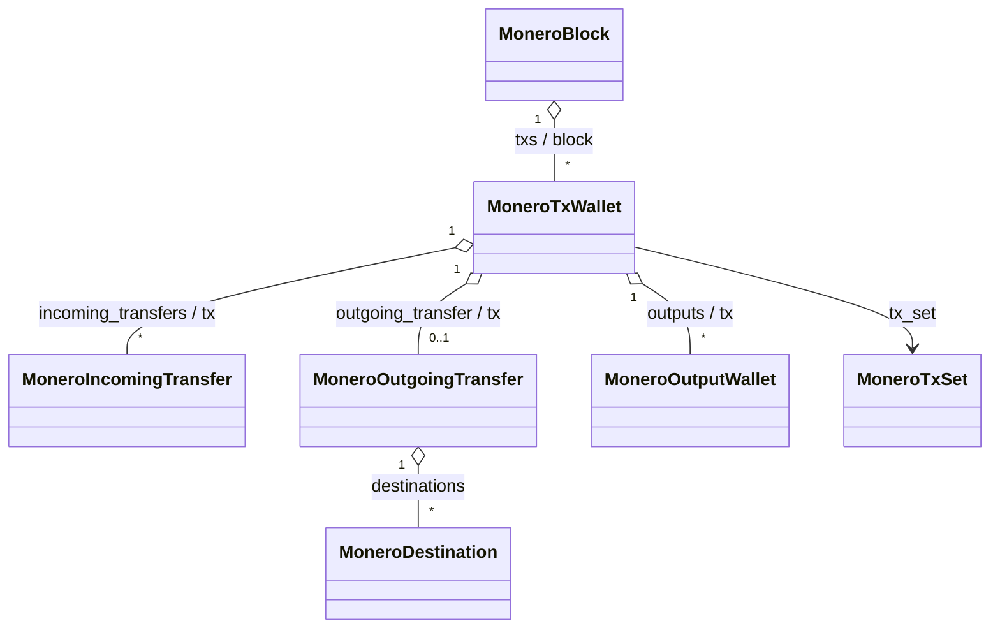
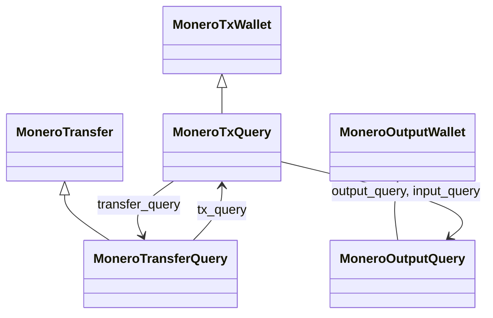

# Wallet Data Model

What the methods of a [wallet](../../wallet.md) take and return, by role. A wallet extends the classes of the daemon with what it knows of
its own: a [`MoneroTxWallet`][monero.MoneroTxWallet] is a [`MoneroTx`][monero.MoneroTx] with its transfers, a
[`MoneroOutputWallet`][monero.MoneroOutputWallet] a [`MoneroOutput`][monero.MoneroOutput] with its account and subaddress
([Daemon Data Model](../daemon/index.md)).

The graph of a transaction of a wallet: each link is there both ways, the name before the slash from the left, the one after from the
right, and [`MoneroUtils.free`][monero.MoneroUtils.free] breaks them ([Memory](../../architecture.md#memory)).

A query is the class that it selects, and holds the queries of the others:

| Page | What it has |
| --- | --- |
| [Configurations and Queries](inputs.md) | what a call takes: the configuration of a wallet and of a payment, the queries, the type of a signature |
| [Accounts and Addresses](accounts.md) | the accounts, the subaddresses, the tags, the integrated and the decoded addresses, the address book |
| [Transactions, Transfers and Outputs](transactions.md) | the transactions of the wallet, their transfers and outputs, the sets of transactions to sign |
| [Results and Notifications](results.md) | what a call returns: the sync, the key images, the checks of the proofs, multisig; and the listener |
